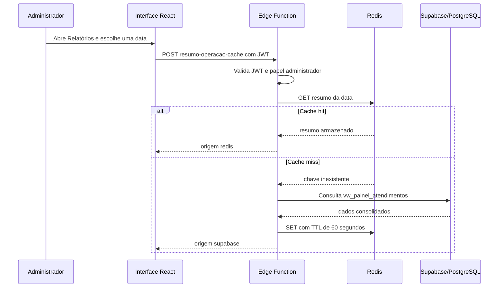

# Integração Supabase e Redis

## Finalidade

O Auto Clean utiliza o Supabase como fonte definitiva dos dados operacionais e financeiros. O Redis foi incorporado para acelerar a consulta repetida do resumo diário exibido para administradores na tela de **Relatórios**.

Esse resumo informa quantidade de atendimentos concluídos, total recebido, parte da empresa e parte da equipe. Como ele é uma agregação consultada várias vezes durante a conferência do dia, o cache evita executar a mesma leitura no PostgreSQL a cada acesso.

## Fluxo utilizado



O botão **Atualizar dados** solicita uma renovação do cache. A aplicação pula a leitura da chave anterior, busca os valores atuais no Supabase e grava uma nova versão no Redis.

## Onde cada tecnologia é usada

| Tecnologia             | Uso no fluxo                                                        |
| ---------------------- | ------------------------------------------------------------------- |
| React                  | Exibe o resumo e informa visualmente a origem da resposta.          |
| Supabase Auth          | Envia e valida a sessão do usuário.                                 |
| Supabase Edge Function | Protege a integração e coordena a leitura entre Redis e PostgreSQL. |
| Supabase/PostgreSQL    | Fonte definitiva; consulta a View `vw_painel_atendimentos`.         |
| Redis                  | Armazena temporariamente o resumo da data por 60 segundos.          |

## Segurança e privacidade

- A função exige JWT e confirma o papel administrativo antes de consultar qualquer dado;
- o token do Redis e a `SUPABASE_SERVICE_ROLE_KEY` ficam somente na Edge Function;
- a interface chama apenas `supabase.functions.invoke`, sem conhecer Secrets;
- a chave Redis usa somente a data de operação: `autoclean:resumo-operacao:v1:AAAA-MM-DD`;
- o valor em cache não inclui cliente, veículo, placa, pagamento individual ou outro dado pessoal;
- se Redis falhar, a função consulta o Supabase e informa o estado `indisponivel`, sem interromper o relatório.

## Configuração necessária

Crie um banco Redis compatível com a API REST do Upstash e, no ambiente do projeto Supabase, cadastre os seguintes Secrets:

```text
UPSTASH_REDIS_REST_URL
UPSTASH_REDIS_REST_TOKEN
```

Os valores não devem ser colocados em `.env.example`, arquivos `VITE_*` ou commits. Para desenvolvimento local, use um arquivo ignorado pelo Git. A função já mantém o fallback ao Supabase enquanto esses Secrets não estiverem configurados.

Após cadastrar os Secrets, publique somente a função:

```bash
supabase functions deploy resumo-operacao-cache --project-ref jkhfhyrwkwzpoteenkyh
```

Esse comando é uma instrução de operação manual; ele não foi executado durante o desenvolvimento desta alteração.

## Evidências automatizadas

O teste `src/test/resumo-operacao-cache.test.ts` verifica cache hit, cache miss, renovação forçada, fallback, JWT, autorização administrativa, CORS, datas inválidas e proteção de Secrets.
